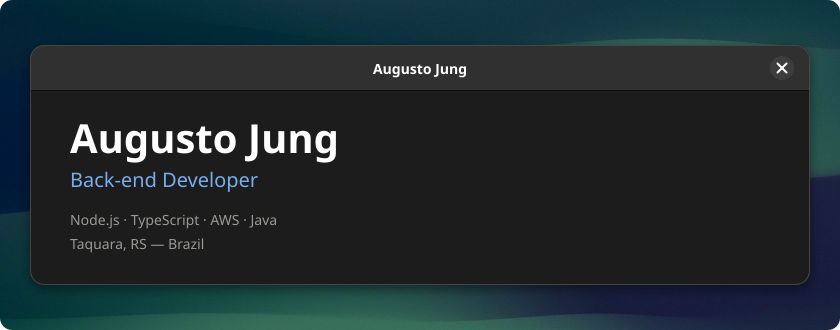

## About me

Back-end developer based in Taquara, Brazil. I build APIs and cloud-based services, with hands-on experience in tourism platforms and AWS infrastructure. I'm also AWS Certified Cloud Practitioner (2025) and have advanced English.

## Languages & Technologies

## Core Skills

- **Back-end development:** REST APIs with Node.js, TypeScript, Java and Spring Boot
- **Cloud:** AWS services, deployment and technical support
- **Databases:** SQL modeling and querying
- **Front-end:** Next.js and React for full-stack work
- **Systems:** Linux server environments

## Links

